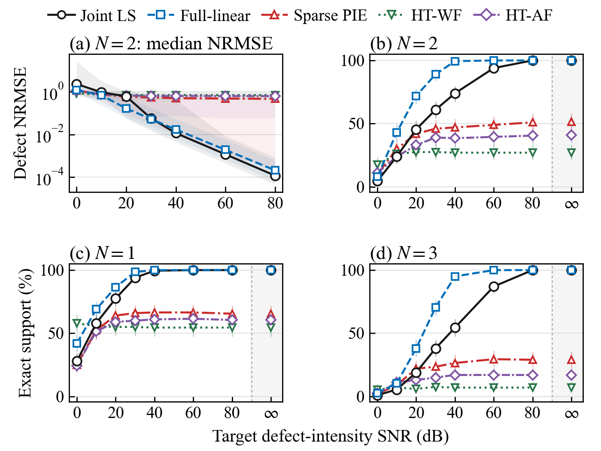
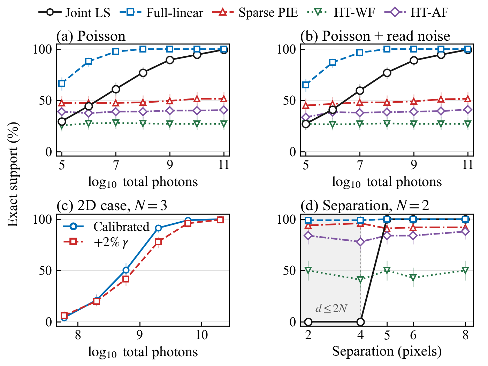

# Figure previews

These figures are generated from the recorded trial data. The JSON files retain
captions and the condition-level statistics plotted in each panel.

```bash
python -m experiments.plot_figures
```

Gaussian comparison:



Photon noise, two-dimensional calibration and separation:


